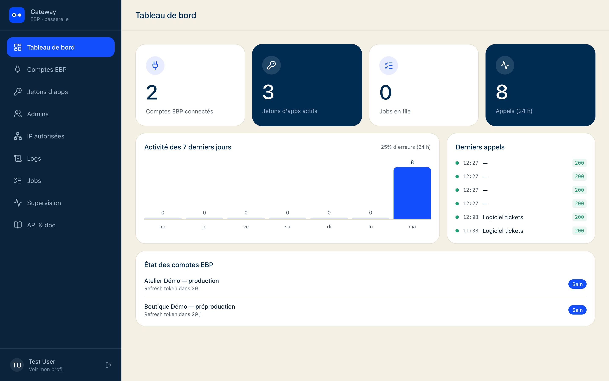
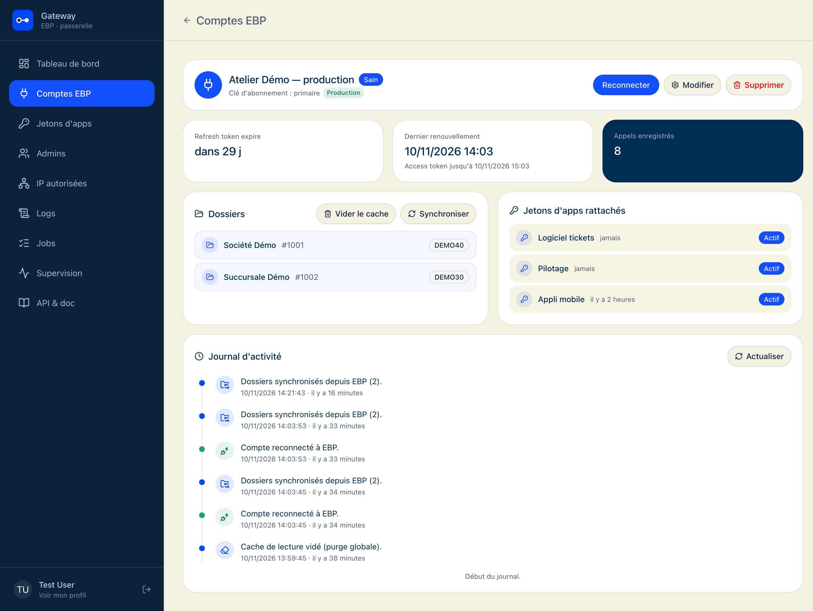
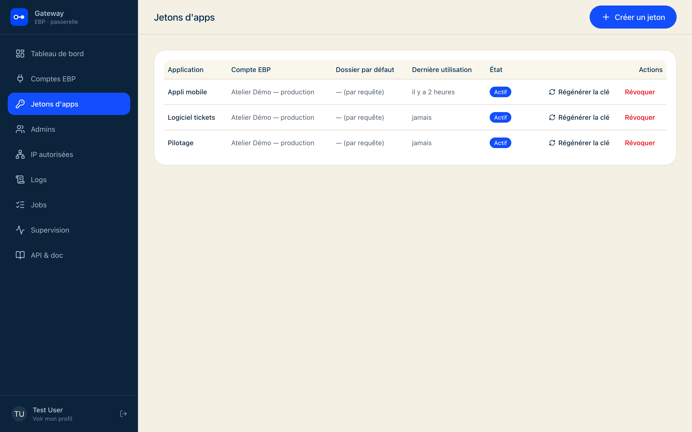
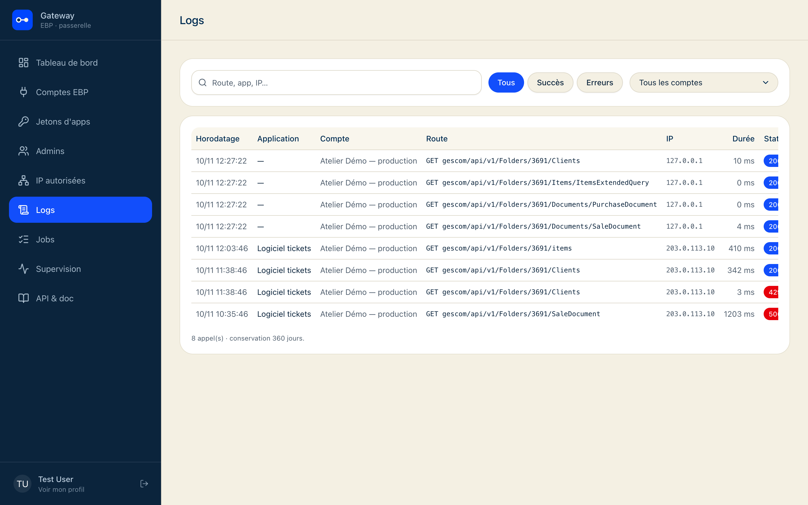
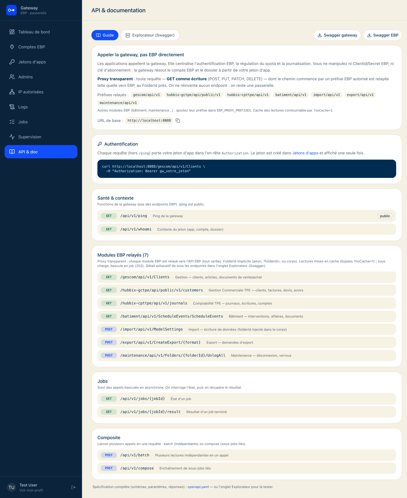
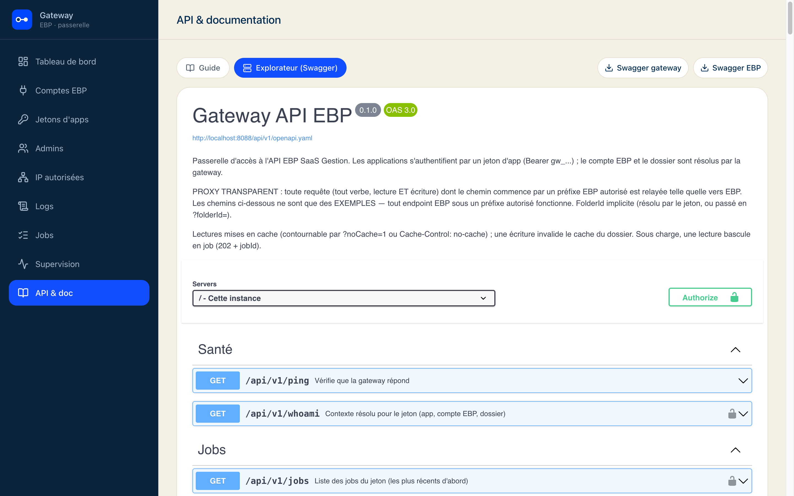

# 🔌 gateway-for-ebp


-DC382D?style=flat-square&logo=redis&logoColor=white)


**Une passerelle open source entre vos applications et l'[API Développeurs EBP](https://developpeurs.ebp.com) (SaaS Gestion)** — elle centralise l'authentification OAuth, la régulation du quota, la mise en file des requêtes lourdes et la journalisation, pour que vos apps parlent à EBP avec un **simple jeton**.

> ⚠️ Ce projet est **indépendant**, non affilié à EBP et non officiel. « EBP » est une marque de son éditeur.

> 🧪 **Statut : en construction.** Les fonctionnalités sont là et testées ; la documentation d'installation détaillée s'étoffe au fil des versions.

---

## 🎯 Le problème que ça résout

Brancher chaque application directement sur l'API EBP est fastidieux — l'API impose plusieurs contraintes :

- 🔐 **OAuth 2.0 Authorization Code uniquement** (pas de machine-to-machine), avec un *refresh token* tournant à renouveler au moins tous les **30 jours** ;
- 🚦 **quota strict** : 1 appel/seconde, 10 000/jour, 100 éléments par page ;
- 🧩 réponses **hétérogènes et peu documentées** ;
- 🔗 une seule **URL de redirection** à faire autoriser par abonnement.

`gateway-for-ebp` encaisse tout ça **une fois pour toutes** : vos applications parlent à la gateway, la gateway s'occupe d'EBP.

---

## 🎉 Fonctionnalités

- 🔑 **Connexion OAuth centralisée**, **multi-comptes** EBP, avec **renouvellement automatique** des jetons (plus de refresh token à surveiller).
- 🪪 **Jetons d'application** : chaque app reçoit un jeton `gw_…` ; la gateway résout le compte EBP et le dossier à sa place. Les apps ne voient **jamais** les secrets EBP.
- 🚦 **Régulation du quota** EBP **globale** (toutes les apps partagent la limite proprement, via Redis).
- 📨 **File d'attente** pour les requêtes lourdes : sous charge, une lecture **bascule en job** (`202` + `jobId`) ; **batch** (appels indépendants) et **compose** (sous-jobs liés) sans coupure par timeout.
- ♻️ **Cache des lectures** paramétrable par compte (TTL, on/off), invalidé par les écritures, contournable par `?noCache=1`.
- 🔁 **Proxy transparent** : tout endpoint EBP (tout verbe, GET comme écriture) sous un préfixe autorisé est relayé **tel quel**. On ne réinvente aucune route — on reste une passerelle.
- 🪵 **Journalisation** complète des échanges + **journal d'activité par compte** (connexions, renouvellements, refus, synchros, actions sur les jetons).
- 🖥️ **Back-office** complet : comptes EBP, jetons d'apps, IP autorisées, logs, jobs, supervision, et documentation d'API intégrée (guide + Swagger).
- 🔒 **Sécurité** : accès admin avec double authentification (2FA), IP autorisées, secrets EBP chiffrés au repos.

---

## 🖼️ Aperçu

### Tableau de bord

Vue d'ensemble : comptes connectés, jetons actifs, jobs en file, appels récents et santé des tokens.



### Comptes EBP & journal d'activité

Chaque compte EBP a sa fiche : état des tokens, dossiers, jetons rattachés, et une **timeline d'activité** (scroll infini + actualisation) qui trace tout ce qui se passe sur le compte.



### Jetons d'applications

Un jeton par application cliente, ciblant un compte EBP (et un dossier par défaut). Révocation et régénération en un clic.



### Journaux des appels

Tous les échanges app → gateway → EBP, filtrables par compte, statut, route, IP.



### Documentation d'API intégrée

Un guide lisible **et** un explorateur Swagger interactif, directement dans le back-office. Les deux spécifications OpenAPI (la gateway + la référence EBP) sont téléchargeables.





---

## 🚀 Démarrage rapide (Docker / Laravel Sail)

Un environnement complet **PHP + MySQL + Redis** est fourni via [Laravel Sail](https://laravel.com/docs/sail) (`compose.yaml`).

```bash
# 1. installer les dépendances
composer install

# 2. configurer l'environnement
cp .env.example .env
php artisan key:generate   # chiffre les secrets EBP — à sauvegarder

# 3. démarrer la stack (app + MySQL + Redis + Mailpit)
./vendor/bin/sail up -d

# 4. préparer la base (avec des données de démo)
./vendor/bin/sail artisan migrate --seed

# 5. file d'attente supervisée (Redis)
./vendor/bin/sail artisan horizon
```

L'app écoute sur `APP_PORT` (`.env`). Le dashboard Horizon est sur `/horizon`, la capture des mails en dev sur Mailpit.

> 💡 Le nom du projet Docker se règle dans `.env` (`COMPOSE_PROJECT_NAME`) pour un nom lisible dans Docker Desktop.

---

## 🔗 Appeler la gateway

Les applications appellent la gateway, **pas EBP directement**. Elles portent leur **jeton d'app** en Bearer ; la gateway résout le compte EBP et le dossier.

```bash
curl https://votre-gateway/gescom/api/v1/Clients \
  -H "Authorization: Bearer gw_votre_jeton"
```

- 📁 **FolderId optionnel partout** (URL, query `?folderId=`, ou corps) : absent, il est résolu depuis le dossier par défaut du jeton. Les deux formes d'URL marchent :
  `GET /gescom/api/v1/Clients` (implicite) **ou** `GET /gescom/api/v1/Folders/{FolderId}/Clients` (explicite).
- ♻️ Cache des lectures contournable par `?noCache=1`.
- 📨 Sous charge, une lecture peut répondre `202` + `jobId` : interrogez `/api/v1/jobs/{jobId}` jusqu'à `done`/`partial`, puis `/result`.

### Erreurs normalisées

| Code | Signification |
|------|---------------|
| `401` | Jeton d'app manquant ou invalide |
| `429` | Quota EBP atteint (régulation) |
| `502` | Erreur renvoyée par EBP en amont |
| `503` | Compte EBP à reconnecter (OAuth rompu) |

Jamais de `500` qui fuite la structure interne : toutes les erreurs sortent en JSON propre.

---

## 📚 Spécifications OpenAPI

Deux specs accompagnent le projet, toutes deux sous [`openapi/`](openapi/) et téléchargeables depuis le back-office (**API & doc**) :

- **[`openapi/gateway.yaml`](openapi/gateway.yaml)** — **notre** API (ce que vos apps appellent) : `ping`, `whoami`, `jobs`, `batch`, `compose` + les 7 modules EBP relayés. Elle est servie en ligne sur `GET /api/v1/openapi.yaml`, explorable dans le back-office, et sert à **générer les SDK**.
- **[`openapi/ebp-reference.yaml`](openapi/ebp-reference.yaml)** — l'API **d'EBP** elle-même, consolidée (7 modules + authentification), à titre de **référence**. On la garde fidèle à EBP, on ne l'invente pas.

Les **7 modules EBP** relayés : Gestion (`gescom`), Gestion Commerciale TPE (`hubbix-gctpe`), Comptabilité TPE (`hubbix-cpttpe`), Bâtiment (`batiment`), Import (`import`), Export (`export`), Maintenance (`maintenance`).

---

## 🧰 Prérequis côté EBP

- Un abonnement à l'**API Développeurs EBP** (offre compatible — SaaS Gestion).
- `ClientId` / `ClientSecret` (reçus par mail d'EBP) et une **clé d'abonnement** (profil développeur).
- Une **URL de redirection** autorisée auprès d'EBP. Pendant l'attente de validation, la gateway propose un **mode de redirection « localhost » avec saisie manuelle du retour** pour amorcer un compte sans attendre.

---

## 🧪 Tests

```bash
# Par défaut : SQLite en mémoire (rapide, CI et dev local)
php artisan test

# Sur MySQL (dans le conteneur Sail, compatibilité SQL réelle)
./vendor/bin/sail artisan test --configuration=phpunit.mysql.xml
```

La suite couvre le proxy (7 modules), le cache, l'authentification OAuth, le journal d'activité et toute la partie **asynchrone** (jobs, batch, compose) — exécutée contre un **mock EBP intégré** (aucun appel réseau réel).

---

## 🏗️ Stack technique

- **PHP 8.3+** / **Laravel 13**
- **Inertia.js** + **Vue 3** (composants shadcn-vue) pour le back-office
- **Horizon** (Redis) pour la file d'attente
- **Laravel Sail** (Docker : PHP + MySQL + Redis + Mailpit)
- **OpenAPI 3.0** + Swagger UI

---

## ⚖️ Ce que ce n'est pas

- ❌ Ce n'est **pas** un produit concurrent d'EBP. C'est un outil qui **facilite** l'usage de l'API EBP.
- ❌ Ce n'est **pas** affilié à EBP ni officiel.

---

## 🧾 Licence

[MIT](LICENSE).
